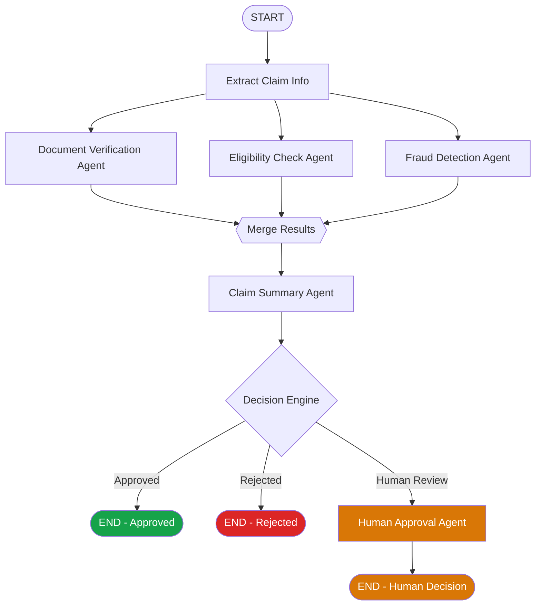

# 🛡️ Meridian Claims — Enterprise AI Insurance Claim Processing Agent


A production-grade, multi-agent AI system that automates end-to-end insurance
claim adjudication — document verification, eligibility checking, fraud
detection, executive summarization, and a deterministic decision engine with
human-in-the-loop escalation — built on **LangGraph**, **Google Gemini 2.5
Flash**, and **Streamlit**.


---

## Table of Contents

- [Why this project](#why-this-project)
- [Architecture at a glance](#architecture-at-a-glance)
- [Workflow diagram](#workflow-diagram)
- [The five agents](#the-five-agents)
- [Decision rules](#decision-rules)
- [Screenshots](#screenshots)
- [Quick start](#quick-start)
- [Project structure](#project-structure)
- [Testing](#testing)
- [Documentation](#documentation)
- [Tech stack](#tech-stack)
- [License](#license)

---

## Why this project

Most "AI claims demo" projects are a single LLM call wrapped in a chat box.
Meridian Claims instead models what a **real underwriting desk** looks like:

- **Auditable, not opaque.** Every boolean/numeric determination (document
  completeness, policy eligibility, fraud score) is computed by
  deterministic, rule-based logic in Python — reproducible and explainable
  to a regulator. The LLM is used specifically for what LLMs are good at:
  reading free text and writing clear narrative explanations.
- **True parallel multi-agent orchestration.** Document Verification,
  Eligibility Check, and Fraud Detection run concurrently as independent
  LangGraph branches, fan back into a synchronization barrier, and feed a
  downstream Claim Summary agent.
- **Real human-in-the-loop**, not a fake "pending" state. Escalated claims
  use LangGraph's native `interrupt()` / `Command(resume=...)` mechanism —
  the graph genuinely pauses mid-execution, checkpointed, and resumes exactly
  where it left off once a reviewer acts inside the Streamlit UI.
- **Graceful degradation.** If `GOOGLE_API_KEY` isn't configured, every agent
  falls back to a deterministic templated narrative instead of crashing —
  the app is fully demoable without live credentials.

---

## Architecture at a glance

```
Streamlit UI  →  ClaimService (facade)  →  LangGraph StateGraph  →  5 Agents  →  Gemini 2.5 Flash
     ↑                                             │
     └──────────────── resumes via Command ────────┘  (human-in-the-loop)
```

See [`ARCHITECTURE.md`](ARCHITECTURE.md) for the full layered breakdown,
design rationale, and data-flow diagrams.

## Workflow diagram



`Document Verification`, `Eligibility Check`, and `Fraud Detection` execute
**concurrently** — they share a single predecessor (`Extract Claim Info`) and
a single successor (`Merge Results`), which is how LangGraph's `StateGraph`
schedules true parallel fan-out. The live topology is also viewable inside
the app under **Dashboard → Workflow Visualization**.

## The five agents

| # | Agent | Deterministic core | LLM contribution |
|---|-------|--------------------|--------------------|
| 1 | **Document Verification** | Required-vs-submitted document check per claim type | Content-quality notes + summary |
| 2 | **Eligibility Check** | Policy active/expiry, coverage period, waiting period, max coverage | Underwriting-language explanation |
| 3 | **Fraud Detection** | Numeric risk score from policy age, coverage ratio, claim frequency, round-number patterns | Narrative red-flag detection from free text |
| 4 | **Claim Summary** | — | Executive summary, evidence summary, business justification |
| 5 | **Human Approval** | Escalation trigger rules + reviewer-decision finalization | — |

## Decision rules

| Condition | Outcome |
|---|---|
| Required documents missing | **Reject** |
| Policy expired / ineligible | **Reject** |
| Fraud risk **HIGH** or **MEDIUM** | **Human Review** |
| Claim ≥ high-value threshold or ≥ coverage-fraction threshold | **Human Review** |
| Documents complete, eligible, fraud risk **LOW** | **Approve** |

Thresholds are configurable in [`core/config/business_rules.py`](core/config/business_rules.py)
and [`.env`](.env.example).

## Screenshots

> _Screenshot placeholders — replace with actual captures before publishing._

| New Claim | Decision Stamp | Fraud Gauge | Human Review |
|---|---|---|---|
| `docs/screenshots/new-claim.png` | `docs/screenshots/decision-stamp.png` | `docs/screenshots/fraud-gauge.png` | `docs/screenshots/human-review.png` |

---

## Quick start

```bash
git clone <your-fork-url>
cd insurance-claim-agent
python -m venv .venv && source .venv/bin/activate   # Windows: .venv\Scripts\activate
pip install -r requirements.txt
cp .env.example .env   # then add your GOOGLE_API_KEY
streamlit run app/main.py
```

Full setup instructions (including Streamlit Community Cloud deployment) are
in [`INSTALLATION.md`](INSTALLATION.md) and [`DEPLOYMENT.md`](DEPLOYMENT.md).

## Project structure

```
insurance-claim-agent/
├── app/                    # Streamlit UI (pages, components, styles)
├── core/                   # config, services (LLM, document, report, claim), utils
├── agents/                 # 5 claim-processing agents
├── langgraph_workflow/     # StateGraph builder, nodes, edges, mermaid export
├── prompts/                # System/user prompt builders per agent
├── schemas/                # Pydantic models + LangGraph TypedDict state
├── tests/                  # unit, integration, service, and scenario tests
├── assets/demo_claims/     # sample claim payloads
└── docs/                   # additional documentation & diagrams
```

## Testing

```bash
pytest -q
```

49 tests across unit (agents, services, schemas), integration (compiled
graph execution incl. parallel fan-out and interrupt/resume), and acceptance
(all 5 mandated scenarios via the same `ClaimService` facade the UI uses).
See [`tests/`](tests/) and the [Testing section of ARCHITECTURE.md](ARCHITECTURE.md#testing-strategy).

## Documentation

| Doc | Purpose |
|---|---|
| [ARCHITECTURE.md](ARCHITECTURE.md) | Layered design, data flow, design decisions |
| [INSTALLATION.md](INSTALLATION.md) | Local setup, environment variables |
| [DEPLOYMENT.md](DEPLOYMENT.md) | Streamlit Community Cloud deployment guide |
| [CONTRIBUTING.md](CONTRIBUTING.md) | Contribution workflow & code style |
| [CHANGELOG.md](CHANGELOG.md) | Version history |
| [SECURITY.md](SECURITY.md) | Vulnerability reporting & data-handling notes |
| [ROADMAP.md](ROADMAP.md) | Planned enhancements |

## Tech stack

Python 3.11+ · LangGraph · LangChain · Google Gemini 2.5 Flash ·
Google Generative AI Embeddings · Streamlit · Pydantic v2 · pypdf · fpdf2 ·
pytest

## License

MIT — see [LICENSE](LICENSE).
